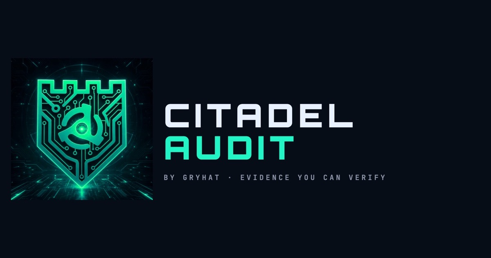
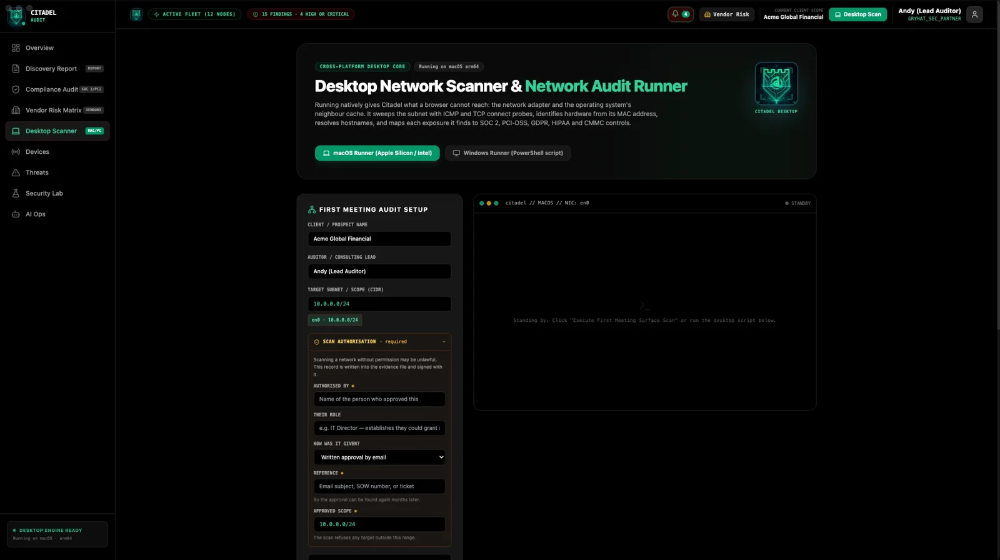
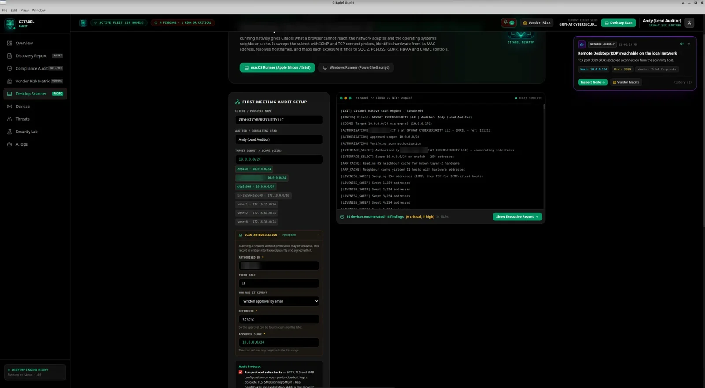
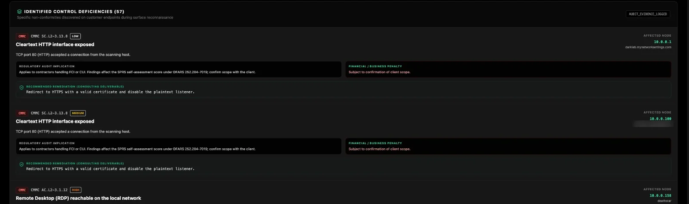
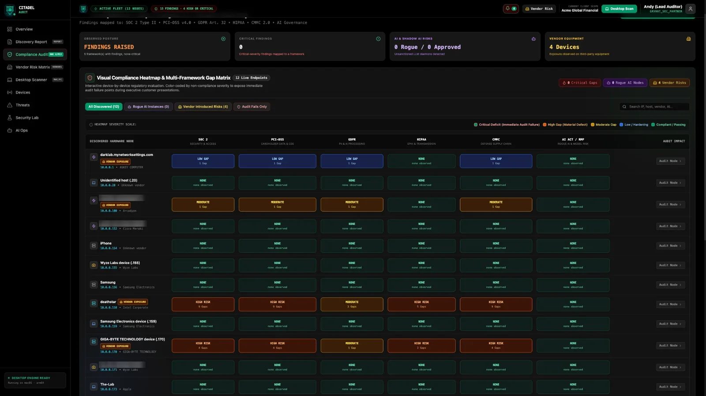
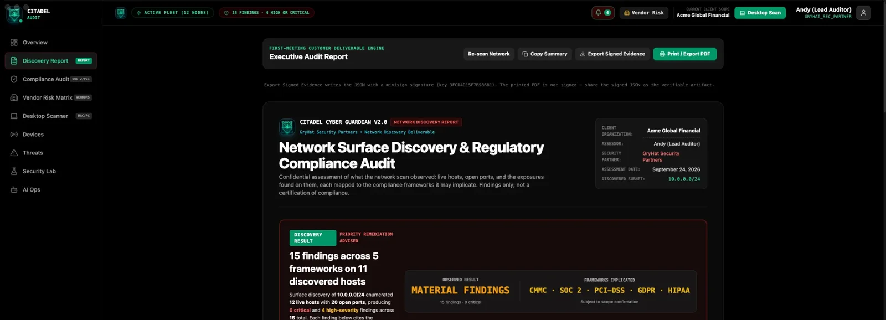
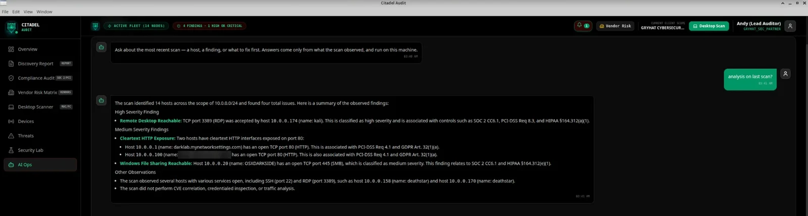

  

# Citadel Audit

**See the subnet. Keep the proof.**

Citadel Audit (application name **Citadel Cyber Guardian**) is a desktop app from [GRY HAT CYBERSECURITY LLC](https://www.gryhat.com) for people who have to show their work: security consultants, MSPs, and contractors preparing for CMMC. It discovers devices on a network you are authorized to scan, maps what it actually observed to specific practices, and signs the evidence before you leave.

The model runs on the laptop. The license is checked on the laptop. Nothing is sent home to us.

This repository is the public download home for insider testers. It holds this page, the [tester site](https://thegryhat.github.io/citadel-audit/), and links to [GitHub Releases](https://github.com/TheGRYHAT/citadel-audit/releases). **It does not contain the application source, and it must not.** Binaries are not stored here either. When a build is posted, it is a Release asset.

| | |
| --- | --- |
| macOS | Verified. Universal DMG. Shipped builds are Developer ID signed and notarized. |
| Linux | Verified. AppImage and `.deb` for x64 and arm64. Full scan verified on Ubuntu 26.04 (x64). |
| Windows | **Experimental preview. Untested.** A live scan has not been verified. Unsigned tester builds trip SmartScreen. |

## What it does

You plug a consultant laptop into a subnet someone has approved in writing. Citadel Audit reads the live adapter, records who approved the range, and refuses any target outside it.

From that sweep you get:

- Hosts, including machines that answer only to a TCP connect after ICMP stays quiet, with names from reverse DNS and a NetBIOS fallback.
- A manufacturer from the IEEE assignment. A randomised address is reported as unattributable. It is not guessed.
- NDAA Section 889 screening by registered organization (FAR 52.204-25).
- Open ports mapped to a fixed set of audit rules: cleartext remote admin, open datastores, databases reachable from a general segment, SMB, and shadow AI servers (Ollama, ComfyUI, Gradio, LM Studio) on the ports distinctive to each.
- A practice identifier on each finding — CMMC 2.0 / NIST SP 800-171, SOC 2, PCI-DSS, HIPAA, GDPR, or an EU AI Act reference — tied to the literal observation. There is no invented "N of M controls passed."
- AI-governance mapping that is **aligned with IAiGACB**. A finding does not certify a model.
- An executive report and an Ed25519-signed evidence file in minisign format. The signature covers the findings and the authorization together. Verify it later with stock [minisign](https://jedisct1.github.io/minisign/) and the public key shipped in the export. Change one record and verification fails.
- An on-device model for narrative and questions. It summarizes what the scan saw and says what it did not assess. There is no cloud API key.

A published lab run of build 2.0.0 walked a /24 in about fifteen seconds and, on Ubuntu, enumerated 14 devices in 10.9 seconds. That is a lab measurement, not a service level.

  

## Who it's for

- **Security consultants** who need a defensible inventory in the first meeting, before a heavier assessment is scoped.
- **MSPs** who would rather not install an agent or collect credentials just to see what is reachable on the segment.
- **CMMC-bound contractors**, and the people preparing them, who need observed evidence mapped to practice IDs. The scan feeds a readiness program. It does not award a certificate, a SPRS score, or an attestation. Those come from an accredited assessor or a licensed CPA firm.

## Key screens

Real screens from the shipped 2.0.0 build on macOS and Linux, captured on our own lab network. The [tester site](https://thegryhat.github.io/citadel-audit/#walkthrough) walks all of them.

   
  <em>The sweep runs only after authorization is on the record.</em>

   
  <em>Every finding names the observation. Severity is exposure on the segment, not a guess about patches.</em>

   
  <em>Framework rows exist because a finding exists. An empty cell is not a pass.</em>

   
  <em>The report you keep. Findings only — not a certification.</em>

   
  <em>The local model is bounded by the scan. It says what it did not assess.</em>

## How it works

1. Install the build for your OS from [Releases](https://github.com/TheGRYHAT/citadel-audit/releases).
2. Open the app. Copy the **Machine ID** on the activation screen.
3. [Request a license key](#request-a-license-key) by email. The key is bound to that machine and checked locally, including with no internet.
4. Record who approved the scan, their role, how they approved it, and the subnet. A target outside that range is refused before a packet is sent.
5. Read the findings. Unknown hardware stays unknown. A scan that enumerates nothing is an error, not a clean network.
6. Keep the signed evidence file. Verify it later without GRYHAT software.

Active testing (anonymous access checks) is a separate, signed rules-of-engagement step. It is not part of discovery consent. Checks that do not apply are skipped and said so. They are not counted as passes.

## Privacy

Zero data egress is the design.

- Discovery and analysis both run on the laptop in the room.
- The on-device model is bundled. A non-private model endpoint is refused.
- There is no license server. A signed key is verified on the machine against an embedded public key. Tampered or expired licenses are rejected.
- The app is built to run on an isolated segment. Do not put client scan data, evidence files, or license keys in a public GitHub issue.

## What it will not claim

- No CVE correlation. "Not assessed" is never written up as "none present."
- No credentialed or agent-based inspection.
- No cloud or SaaS estate. One on-premises subnet per scan.
- No exploitation. Safe-checks observe a service's own response. Pro active tests do not brute-force, send exploit payloads, or write to a host.
- No traffic capture, and no breach detection. Exposure is not compromise.
- A finding is not an audit opinion.
- Windows is not a verified platform.

## System requirements

Run it on a computer that is actually attached to the subnet you were allowed to scan. Activation and discovery do not need internet.

| Platform | What is verified | Package |
| --- | --- | --- |
| macOS | Yes, on real hardware. Shipped builds are Developer ID signed and notarized. | Universal DMG |
| Linux | Yes. Full scan verified on Ubuntu 26.04 (x64). | AppImage and `.deb`, x64 and arm64 |
| Windows | **No. Experimental preview, untested.** | Preview build only, if one is posted |

Disk size and the oldest OS version are properties of the file on the Releases page. This page will not invent them. The installer includes the local model, so it is a full desktop build.

## Download

**[GitHub Releases →](https://github.com/TheGRYHAT/citadel-audit/releases)**

If the Releases page has no assets, a tester build has not been published yet.

### macOS

1. Open the DMG and drag Citadel Audit to Applications.
2. The first launch can ask you to confirm an app downloaded from the internet. That is normal for a file from a browser.
3. **Gatekeeper.** A notarized build should not warn that the developer cannot be verified. If a tester build does, that file was not notarized: System Settings → Privacy & Security → Open Anyway. If macOS says the file is damaged, download it again rather than stripping quarantine by hand.

### Linux

1. AppImage: `chmod +x` the file and run it. Some desktops need FUSE before an AppImage will start.
2. Debian package: `sudo apt install ./the-package.deb` from the folder that contains the download.
3. A failure to start is worth a feedback issue. The distro and the error text are enough. Leave scan output out.

### Windows — experimental preview, untested

1. A live scan on Windows has not been verified. Do not deliver an audit from a Windows preview.
2. **SmartScreen.** Tester builds are unsigned. Windows will say it protected your PC. More info → Run anyway is the path for a tester file. It is not a promise that the build is finished or signed.
3. Do not quote a Windows result as a verified Citadel Audit scan.

## Request a license key

Licenses are machine-bound. Tester builds show a **Machine ID** (the machine serial) on the **activation screen** — the screen you get when the app does not yet have a license. Copy that value.

Requests are private. Do not open a GitHub issue for a key.

Send name, company, email, OS, and Machine ID to **andy@gryhat.com** with the subject **Citadel Audit license request**:

**[Email a license request](mailto:andy@gryhat.com?subject=Citadel%20Audit%20license%20request&body=Name%3A%0ACompany%3A%0AEmail%3A%0AOS%3A%0AMachine%20ID%3A%0A%0AA%20machine-bound%20license%20key%20is%20requested%20for%20the%20Machine%20ID%20above.%0A)**

The same form, with a preview of the email, is on the tester site: [Request a license key](https://thegryhat.github.io/citadel-audit/request.html). If the app is already licensed when it opens, you do not need another key for that machine.

Include nothing else. No scan results, addresses, hostnames, evidence files, or client names.

## Feedback

Bugs and product notes go through [the issue form](https://github.com/TheGRYHAT/citadel-audit/issues/new/choose). The form asks you to confirm you are not attaching network data. A public ticket is the wrong place for a client's subnet.

Security reports go to andy@gryhat.com. See [SECURITY.md](SECURITY.md).

The evaluation terms are a draft for review, marked as such in [LICENSE](LICENSE).

## For maintainers: turn on GitHub Pages

The site is static files in [`/docs`](docs/). There is no build step and no CDN.

1. Merge this into the `public` branch.
2. On GitHub: **Settings → Pages → Build and deployment → Deploy from a branch**.
3. Branch: **`public`**. Folder: **`/docs`**. Save.
4. The site is then [https://thegryhat.github.io/citadel-audit/](https://thegryhat.github.io/citadel-audit/). The license form is `request.html` on that host.

Until Pages is enabled, the README mailto above is the working request path.
